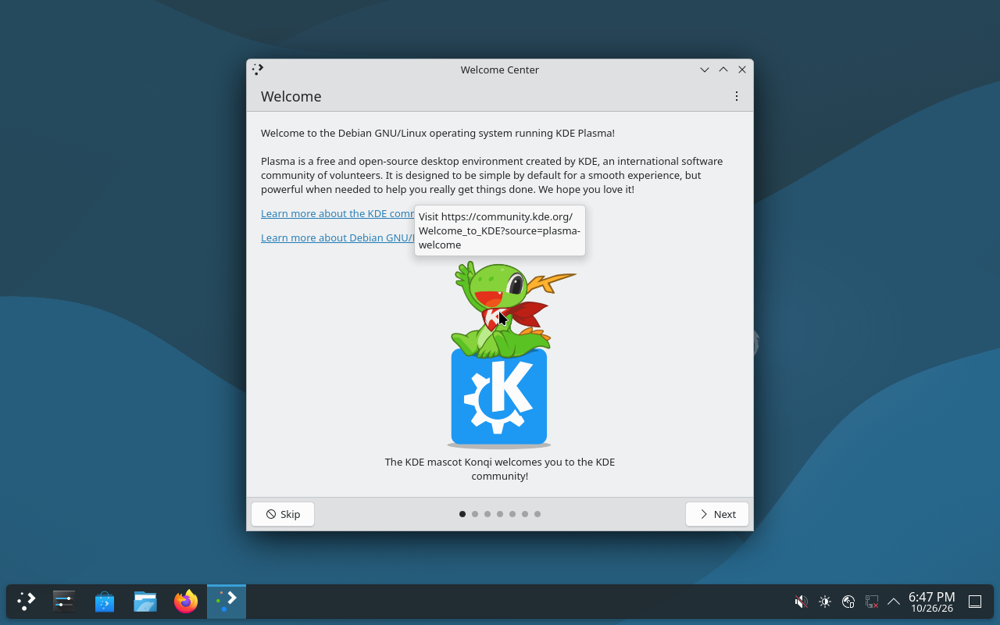

# Drunk Yeti PlaySpace Linux

A useful Linux desktop with an optional game world, desktop companion and creative tools.

**Development integration preview · Debian 13 / KDE · amd64 (x86_64) · October 26, 2026**

[Download the preview](https://github.com/Drunk-Yeti-Limited/Drunk-Yeti-Linux/releases/tag/integration-preview-2026-10-26) · [Detailed instructions](INSTALLATION.md) · [Build status](BUILD-STATUS.md)

> This is a live-session development preview, not the finished 1.0 release. There is no disk installer or configured persistence. Save your work outside the live session before shutting down.

## Actual boot screenshots

These captures come from the BIOS VM inspection of the released ISO (run `40379229619`). They show the current image, not concept artwork.

### Boot menu


Choose **Live system (amd64)** and press **Enter**.

### KDE desktop



The automated test reached this desktop at 300 seconds. The custom Yeti shell is **not visible** in this capture; its autostart and complete desktop integration remain unverified. Actual boot time varies.

## Download and assemble

The complete ISO is **3,959,422,976 bytes (about 3.96 GB)**. It is published as two parts because GitHub limits individual release assets to under 2 GiB. Both parts are required; neither part boots by itself.

1. Create an empty folder and allow **at least 8 GB of free space**.
2. Download these three files into that same folder, retaining their exact names:

| File | Download |
| --- | --- |
| ISO part 1 | [drunk-yeti-integration-preview-amd64.hybrid.iso.part01](https://github.com/Drunk-Yeti-Limited/Drunk-Yeti-Linux/releases/download/integration-preview-2026-10-26/drunk-yeti-integration-preview-amd64.hybrid.iso.part01) |
| ISO part 2 | [drunk-yeti-integration-preview-amd64.hybrid.iso.part02](https://github.com/Drunk-Yeti-Limited/Drunk-Yeti-Linux/releases/download/integration-preview-2026-10-26/drunk-yeti-integration-preview-amd64.hybrid.iso.part02) |
| Assembly script for macOS/Linux | [Assemble-ISO.command](https://github.com/Drunk-Yeti-Limited/Drunk-Yeti-Linux/releases/download/integration-preview-2026-10-26/Assemble-ISO.command) |

3. Assemble using the instructions for your computer below.
4. Boot the resulting `drunk-yeti-integration-preview-amd64.hybrid.iso` in a VM.

GitHub's **Source code (zip)** and **Source code (tar.gz)** downloads contain this repository's documentation and scripts, **not the operating-system ISO**.

### macOS or Linux

Open Terminal, change to the download folder, and run:

```sh
bash Assemble-ISO.command
```

The script verifies each part, joins them in order, and verifies the complete ISO. Wait for **Verified ISO ready** (or **Existing ISO verified**). Do not use the image if verification fails.

### Windows

Open **Command Prompt** in the folder containing both parts. Make sure a previous output ISO is not already present, then run:

```bat
copy /b "drunk-yeti-integration-preview-amd64.hybrid.iso.part01"+"drunk-yeti-integration-preview-amd64.hybrid.iso.part02" "drunk-yeti-integration-preview-amd64.hybrid.iso"
certutil -hashfile "drunk-yeti-integration-preview-amd64.hybrid.iso" SHA256
```

Compare the reported hash with the value below before booting. Use Command Prompt for `copy /b`; PowerShell's `copy` alias is a different command. These Windows commands have not yet been tested in this project's release validation.

### Expected ISO checksum

```text
166d1ff8fddd74cfb8d359fff39b1e5f1a066af59455ff3e8705a21fbda62c42
```

[SHA256SUMS](https://github.com/Drunk-Yeti-Limited/Drunk-Yeti-Linux/releases/download/integration-preview-2026-10-26/SHA256SUMS) · [Exact file sizes and part hashes](release-manifest.json)

Checksums detect corruption; they are not digital signatures.

## Start a live VM

| Setting | Preview guidance |
| --- | --- |
| Guest architecture | x86_64 / amd64 |
| RAM | Start with 4 GB |
| Virtual CPU cores | Start with 2 |
| Boot media | Attach the assembled ISO as the virtual CD/DVD |
| Firmware | BIOS was tested; UEFI boot remains untested |
| Boot selection | **Live system (amd64)**, then **Enter** |

On **Apple Silicon**, use an **x86_64 emulated** VM in UTM. ARM virtualization cannot boot this amd64 ISO. Mac emulation performance has not been measured. On an Intel/AMD computer, use an x86_64 VM.

Start with a disposable VM. This preview does not provide a supported physical-disk installation workflow. See [INSTALLATION.md](INSTALLATION.md) for more detail.

## Included work and current limits

Included work covers the Yeti desktop shell, account and owned-theme integrations, optional snow and stars, and recovered creative-suite sources. Inclusion does not mean every feature has passed end-to-end testing.

| Area | Current evidence |
| --- | --- |
| ISO build and reassembly | Passed; full ISO and part checksums verified |
| BIOS desktop boot | KDE desktop reached in the automated VM test |
| Yeti shell autostart | Unverified; not visible in the final capture |
| Creative apps and Makers | Some launchers and Linux exports remain unfinished |
| Desktop Buddy | Full behavior parity remains incomplete |
| Accounts and owned themes | Live sign-in, purchases, switching and revocation need end-to-end testing |
| UEFI, Secure Boot and hardware | Not validated |
| Installer, persistence, native ARM ISO | Not included |

This build combines the recovered RC1 core with newer integrations. The complete earlier overhaul has not been recovered. See [BUILD-STATUS.md](BUILD-STATUS.md) and [release acceptance](RELEASE-CHECKLIST.md) for the full evidence and limitations.

## Troubleshooting

- **Download failed:** retry the affected part from the release page. Avoid temporary chat download links.
- **Missing part:** put both parts beside the script and preserve their exact names; remove browser-added duplicate suffixes only after identifying the correct download.
- **Checksum mismatch:** do not boot the file. Download the affected part again. On macOS/Linux the script identifies a mismatched part.
- **Existing ISO differs:** move the old output aside and rerun assembly.
- **Still at the boot menu:** select Live system and press Enter. Allow several minutes for startup.
- **Only KDE appears:** that matches the current captured boot evidence; the custom Yeti shell still requires autostart diagnosis.
- **Files disappear after shutdown:** this is a live session without configured persistence. Save important files outside it before shutdown.

## Repository and screenshot provenance

This public repository contains download guidance, screenshots, checksums and release assets. Application development source remains in the private `Drunk-Yeti-Limited/DrunkYetiPlaySpace-Source` repository.

The ISO was built from source revision `f06555ca6613db653b36d195c6c1f5e2608e6a81`, build run `40374303793`. The screenshots were recovered from boot inspection artifact `12678283075` (run `40379229619`); original PPM captures were converted losslessly to PNG without changing their contents.
