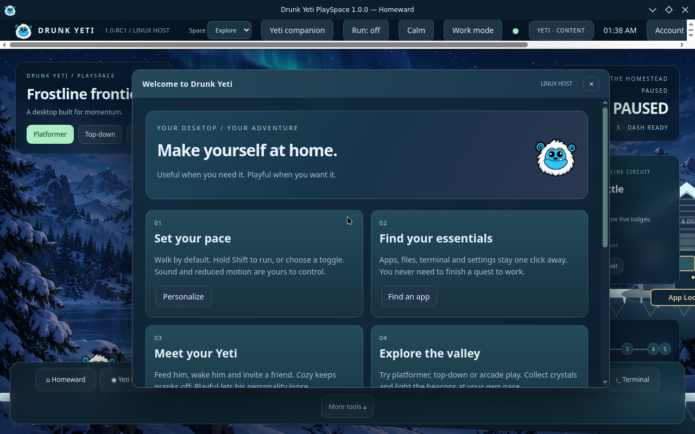
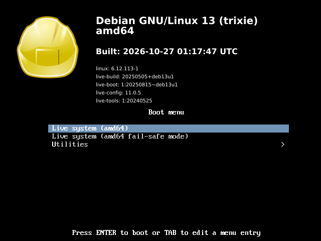

# Drunk Yeti PlaySpace Linux

A useful Linux desktop with an optional game world, desktop companion and creative tools.

**Development integration preview · Debian 13 · PlaySpace X11 session · amd64 (x86_64)**

[Download the preview](https://github.com/Drunk-Yeti-Limited/Drunk-Yeti-Linux/releases/tag/playspace-preview-2026-10-27) · [Detailed instructions](INSTALLATION.md) · [Build status](BUILD-STATUS.md)

> This is a live-session development preview, not the finished 1.0 release. There is no disk installer or configured persistence. Save your work outside the live session before shutting down.

## Latest tested build: PlaySpace boots directly

**The rebuilt ISO reaches the PlaySpace interface in the BIOS VM test.** The actual ten-minute capture below shows the Yeti welcome screen and PlaySpace running. This replaces the earlier black-screen result for the rebuilt image.

**Download status:** the public release linked below now contains this tested PlaySpace-only rebuild. Download both ISO parts and the assembly script from the new release; do not mix them with files from the earlier October 26 KDE release.

### Running PlaySpace — ten minutes after boot



### Boot menu of the tested ISO



The boot menu still displays Debian artwork; complete boot branding is not visually accepted. The session configuration selects PlaySpace X11, using KWin for windows without launching the Plasma desktop or offering KDE/GNOME sessions.

ISO source: `f7622b2443fa2fef10fbf494191ad6c75012de29`; build and normal boot capture: [run 40430362637](https://github.com/Drunk-Yeti-Limited/DrunkYetiPlaySpace-Source/actions/runs/40430362637). A separate session check completed in [run 40432406032](https://github.com/Drunk-Yeti-Limited/DrunkYetiPlaySpace-Source/actions/runs/40432406032). These source-repository links require access.

The normal capture is blank at 300 seconds and shows PlaySpace at 600 seconds; startup remains slow in this VM. This is boot evidence, not a full feature tour, hardware certification or UEFI acceptance. [Capture provenance and historical results](docs/screenshots/README.md).

## Yeti desktop direction

PlaySpace is the only configured desktop session in the rebuilt image. Buddy retains its shared local profile and separate desktop-buddy mode. Live-session data still requires external saving because persistence is not configured.

Yeti branding is configured across the source, but each screen still needs visual acceptance. The screenshot above verifies the PlaySpace welcome interface; the stock Debian boot menu above shows that boot artwork still needs work.

## Download and assemble

**These downloads are the tested PlaySpace-only rebuild shown above.**

The complete ISO is **3,955,556,352 bytes (about 3.96 GB)**. It is published as two parts because GitHub limits individual release assets to under 2 GiB. Both parts are required; neither part boots by itself.

1. Create an empty folder and allow **at least 8 GB of free space**.
2. Download these three files into that same folder, retaining their exact names:

| File | Download |
| --- | --- |
| ISO part 1 | [drunk-yeti-integration-preview-amd64.hybrid.iso.part01](https://github.com/Drunk-Yeti-Limited/Drunk-Yeti-Linux/releases/download/playspace-preview-2026-10-27/drunk-yeti-integration-preview-amd64.hybrid.iso.part01) |
| ISO part 2 | [drunk-yeti-integration-preview-amd64.hybrid.iso.part02](https://github.com/Drunk-Yeti-Limited/Drunk-Yeti-Linux/releases/download/playspace-preview-2026-10-27/drunk-yeti-integration-preview-amd64.hybrid.iso.part02) |
| Assembly script for macOS/Linux | [Assemble-ISO.command](https://github.com/Drunk-Yeti-Limited/Drunk-Yeti-Linux/releases/download/playspace-preview-2026-10-27/Assemble-ISO.command) |

3. Assemble using the instructions for your computer below.
4. Boot the resulting `drunk-yeti-integration-preview-amd64.hybrid.iso` in a VM.

GitHub's **Source code (zip)** and **Source code (tar.gz)** downloads contain this repository's documentation and scripts, **not the operating-system ISO**.

### macOS or Linux

Open Terminal, change to the download folder, and run:

```sh
bash Assemble-ISO.command
```

The script verifies each part, joins them in order, and verifies the complete ISO. Wait for **Verified ISO ready** (or **Existing ISO verified**). Do not use the image if verification fails.

### Windows

Open **Command Prompt** in the folder containing both parts. Make sure a previous output ISO is not already present, then run:

```bat
copy /b "drunk-yeti-integration-preview-amd64.hybrid.iso.part01"+"drunk-yeti-integration-preview-amd64.hybrid.iso.part02" "drunk-yeti-integration-preview-amd64.hybrid.iso"
certutil -hashfile "drunk-yeti-integration-preview-amd64.hybrid.iso" SHA256
```

Compare the reported hash with the value below before booting. Use Command Prompt for `copy /b`; PowerShell's `copy` alias is a different command. These Windows commands have not yet been tested in this project's release validation.

### Expected ISO checksum

```text
ca7935534d004c8b35228606eba36c75621d3ced5f1da2b34c21623dfb8f0f04
```

[SHA256SUMS](https://github.com/Drunk-Yeti-Limited/Drunk-Yeti-Linux/releases/download/playspace-preview-2026-10-27/SHA256SUMS) · [Exact file sizes and part hashes](release-manifest.json)

Checksums detect corruption; they are not digital signatures.

## Start a live VM

| Setting | Preview guidance |
| --- | --- |
| Guest architecture | x86_64 / amd64 |
| RAM | Start with 4 GB |
| Virtual CPU cores | Start with 2 |
| Boot media | Attach the assembled ISO as the virtual CD/DVD |
| Firmware | BIOS was tested; UEFI boot remains untested |
| Boot selection | **Live system (amd64)**, then **Enter** |

On **Apple Silicon**, use an **x86_64 emulated** VM in UTM. ARM virtualization cannot boot this amd64 ISO. Mac emulation performance has not been measured. On an Intel/AMD computer, use an x86_64 VM.

Start with a disposable VM. This preview does not provide a supported physical-disk installation workflow. See [INSTALLATION.md](INSTALLATION.md) for more detail.

## Included work and current limits

Included work covers the Yeti desktop shell, account and owned-theme integrations, optional snow and stars, and recovered creative-suite sources. Inclusion does not mean every feature has passed end-to-end testing.

| Area | Current evidence |
| --- | --- |
| ISO build and reassembly | Passed; full ISO and part checksums verified |
| BIOS desktop boot | Published rebuild reaches PlaySpace at 600 seconds |
| PlaySpace session startup | Visible in the rebuilt ISO's normal BIOS boot capture |
| Creative apps and Makers | Some launchers and Linux exports remain unfinished |
| Desktop Buddy | Full behavior parity remains incomplete |
| Accounts and owned themes | Live sign-in, purchases, switching and revocation need end-to-end testing |
| UEFI, Secure Boot and hardware | Not validated |
| Installer, persistence, native ARM ISO | Not included |

This build combines the recovered RC1 core with newer integrations. The complete earlier overhaul has not been recovered. See [BUILD-STATUS.md](BUILD-STATUS.md) and [release acceptance](RELEASE-CHECKLIST.md) for the full evidence and limitations.

## Session behavior

The published rebuild selects the PlaySpace X11 session and uses KWin to manage windows without starting Plasma. Startup reached the visible PlaySpace welcome interface at 600 seconds in the normal BIOS VM test. A blank screen at five minutes occurred during that test, so allow several minutes for startup.

The earlier KDE release remains available under its original October 26 tag for historical reference. Its user-service troubleshooting instructions do not describe the direct PlaySpace session.

## Troubleshooting

- **Download failed:** retry the affected part from the release page. Avoid temporary chat download links.
- **Missing part:** put both parts beside the script and preserve their exact names; remove browser-added duplicate suffixes only after identifying the correct download.
- **Checksum mismatch:** do not boot the file. Download the affected part again. On macOS/Linux the script identifies a mismatched part.
- **Existing ISO differs:** move the old output aside and rerun assembly.
- **Still at the boot menu:** select Live system and press Enter. Allow several minutes for startup.
- **Only KDE appears:** verify you downloaded both parts from the new PlaySpace release, not the earlier October 26 release. Do not mix release files.
- **Blank screen during rebuilt-image startup:** the normal test remained blank at 300 seconds and reached PlaySpace by 600 seconds. Earlier failed images selected Plasma Wayland and hit graphics errors; the replacement selects PlaySpace X11. A persistent blank screen still needs guest-log diagnosis.
- **Files disappear after shutdown:** this is a live session without configured persistence. Save important files outside it before shutdown.

## Repository and screenshot provenance

This public repository contains download guidance, screenshots, checksums and release assets. Application development source remains in the private `Drunk-Yeti-Limited/DrunkYetiPlaySpace-Source` repository.

The current public ISO is built from source `f7622b2443fa2fef10fbf494191ad6c75012de29`, run `40430362637`, with SHA-256 `ca7935534d004c8b35228606eba36c75621d3ced5f1da2b34c21623dfb8f0f04`. The public release parts and supporting files are checked against their published asset digests.

The earlier public-release ISO was built from source revision `f06555ca6613db653b36d195c6c1f5e2608e6a81`, build run `40374303793`. The screenshots were recovered from boot inspection artifact `12678283075` (run `40379229619`); original PPM captures were converted losslessly to PNG without changing their contents.
